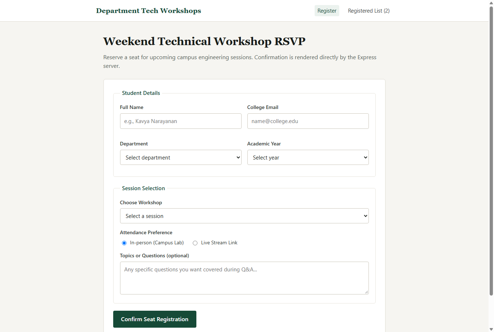
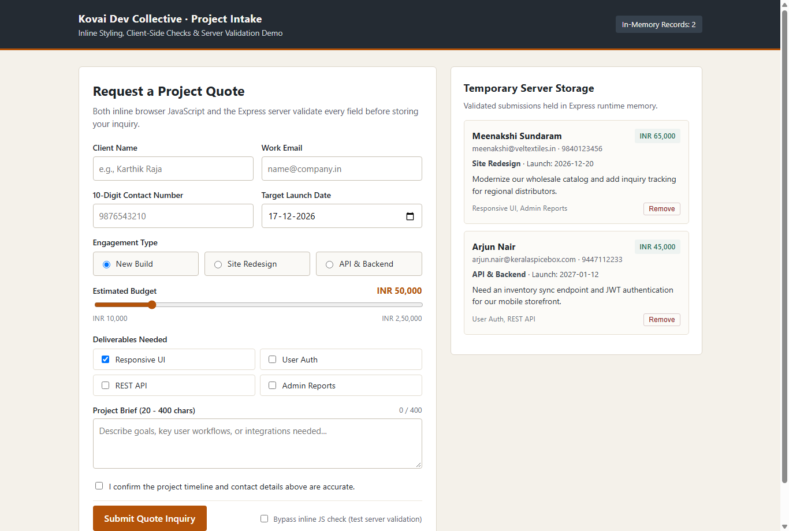
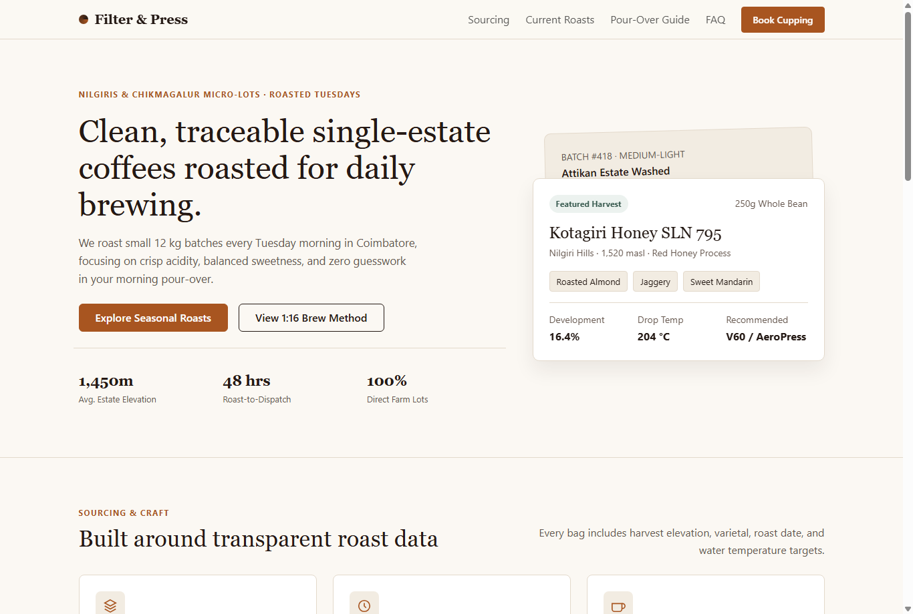
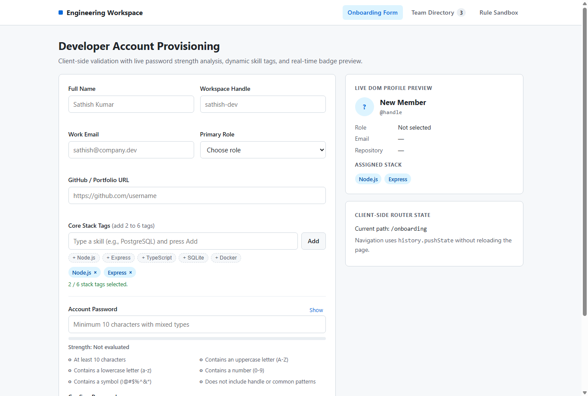
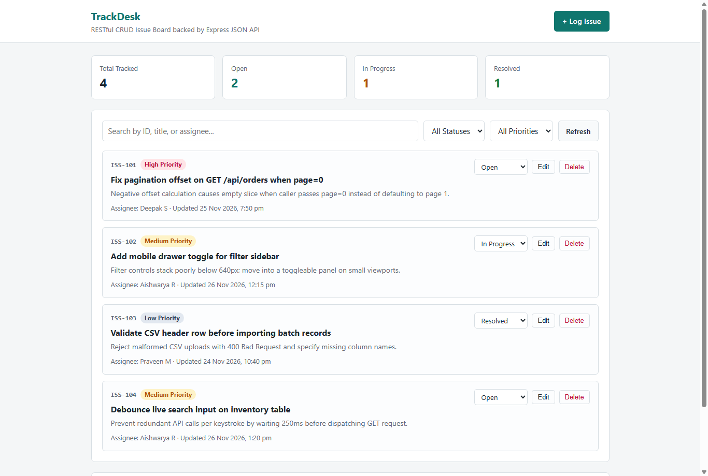
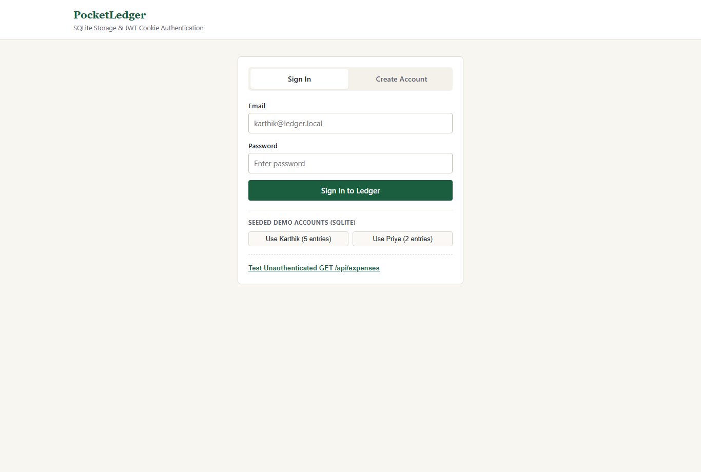
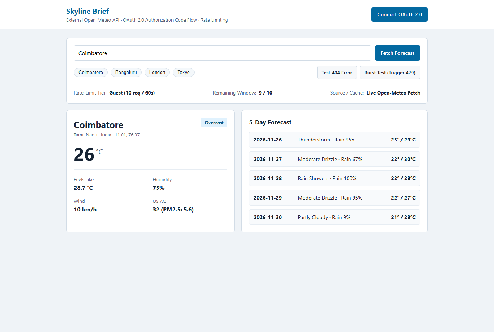
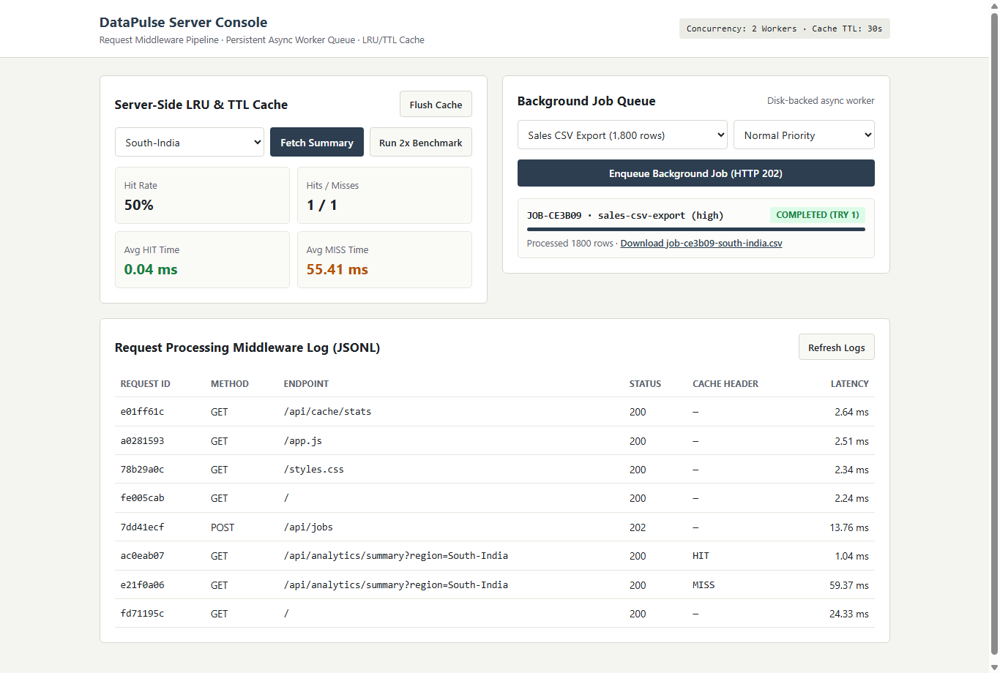

# Cognifyz Technologies — Full Stack Development Internship

Completed full-stack engineering portfolio for the **Cognifyz Technologies Full Stack Development Internship** by **Jeeviraj V** ([@jeevicyber28](https://github.com/jeevicyber28)).

All **8 tasks across all 4 levels** (Beginner, Intermediate, Advanced, Expert) are implemented as standalone, runnable Node.js/Express applications using **100% free and open-source tools** — zero paid APIs, cloud database subscriptions, or external billing keys required.

---

## Task Index & Overview

| Level | Task | Project | Directory | Port | Core Stack | Status |
|---|---|---|---|---|---|---|
| **Level 1: Beginner** | Task 1 | Campus Workshop RSVP Desk | [`Level_1_Beginner/Task_1_SSR_Forms/`](Level_1_Beginner/Task_1_SSR_Forms/) | `3001` | HTML5 Forms, Express, EJS SSR | Completed |
| **Level 1: Beginner** | Task 2 | Freelance Quote & Validation Intake | [`Level_1_Beginner/Task_2_Inline_Validation/`](Level_1_Beginner/Task_2_Inline_Validation/) | `3002` | Inline CSS, Inline JS, Server Validation | Completed |
| **Level 2: Intermediate** | Task 3 | Filter & Press Roastery Showcase | [`Level_2_Intermediate/Task_3_Responsive_Layout/`](Level_2_Intermediate/Task_3_Responsive_Layout/) | `3003` | Bootstrap 5.3, Custom CSS Transitions | Completed |
| **Level 2: Intermediate** | Task 4 | DevPortal Account Onboarding | [`Level_2_Intermediate/Task_4_Dynamic_Validation_Routing/`](Level_2_Intermediate/Task_4_Dynamic_Validation_Routing/) | `3004` | Complex Validation, Dynamic DOM, History API | Completed |
| **Level 3: Advanced** | Task 5 | TrackDesk Issue Tracker | [`Level_3_Advanced/Task_5_REST_API_CRUD/`](Level_3_Advanced/Task_5_REST_API_CRUD/) | `3005` | REST CRUD API, Fetch Client, JSON Storage | Completed |
| **Level 3: Advanced** | Task 6 | PocketLedger Expense Book | [`Level_3_Advanced/Task_6_Database_Auth/`](Level_3_Advanced/Task_6_Database_Auth/) | `3006` | SQLite (`sql.js`), `bcryptjs`, JWT Cookies | Completed |
| **Level 4: Expert** | Task 7 | Skyline Brief Weather & OAuth Hub | [`Level_4_Expert/Task_7_External_API_OAuth/`](Level_4_Expert/Task_7_External_API_OAuth/) | `3007` | OAuth 2.0 Code Flow, Open-Meteo, Rate Limiter | Completed |
| **Level 4: Expert** | Task 8 | DataPulse Queue & Cache Server | [`Level_4_Expert/Task_8_Middleware_Jobs_Cache/`](Level_4_Expert/Task_8_Middleware_Jobs_Cache/) | `3008` | Middleware Logging, Async Job Queue, LRU Cache | Completed |

---

## Repository Structure

```text
Cognifyz_FullStack_Internship/
├── README.md
├── .gitignore
├── Level_1_Beginner/
│   ├── Task_1_SSR_Forms/                    # EJS server-side rendering & HTML forms
│   │   ├── server.js
│   │   ├── views/                           # index.ejs, confirmation.ejs, attendees.ejs
│   │   ├── public/styles.css
│   │   └── outputs/preview.png
│   └── Task_2_Inline_Validation/            # Inline CSS/JS + Express server validation
│       ├── server.js
│       ├── views/quote.ejs
│       └── outputs/preview.png
├── Level_2_Intermediate/
│   ├── Task_3_Responsive_Layout/            # Multi-section Bootstrap 5 + custom CSS
│   │   ├── server.js
│   │   ├── public/                          # index.html, styles.css, app.js
│   │   └── outputs/preview.png
│   └── Task_4_Dynamic_Validation_Routing/   # Password strength, live DOM, SPA router
│       ├── server.js
│       ├── public/                          # index.html, styles.css, app.js
│       └── outputs/preview.png
├── Level_3_Advanced/
│   ├── Task_5_REST_API_CRUD/                # RESTful CRUD API & JSON persistence
│   │   ├── server.js
│   │   ├── data/issues.json
│   │   ├── public/
│   │   └── outputs/preview.png
│   └── Task_6_Database_Auth/                # SQLite database + bcrypt/JWT auth
│       ├── server.js
│       ├── db/                              # schema.sql, database.js
│       ├── middleware/auth.js
│       ├── routes/                          # auth.js, expenses.js
│       ├── public/
│       └── outputs/preview.png
└── Level_4_Expert/
    ├── Task_7_External_API_OAuth/           # OAuth 2.0, Open-Meteo API, rate limiter
    │   ├── server.js
    │   ├── .env.example
    │   ├── middleware/                      # rateLimiter.js, errorHandler.js
    │   ├── services/                        # weatherService.js, oauthService.js
    │   ├── public/
    │   └── outputs/preview.png
    └── Task_8_Middleware_Jobs_Cache/        # Logging middleware, job queue, LRU cache
        ├── server.js
        ├── .env.example
        ├── middleware/                      # requestContext.js, errorHandler.js
        ├── cache/cacheStore.js
        ├── queue/jobQueue.js
        ├── public/
        └── outputs/preview.png
```

---

## Prerequisites & General Setup

- **Node.js:** v18 LTS or newer (tested on Node.js `v24.20.0`)
- **npm:** v9+

### Clone and Run Any Task

```bash
git clone https://github.com/jeevicyber28/Cognifyz_FullStack_Internship.git
cd Cognifyz_FullStack_Internship

# Navigate to any task directory, install dependencies, and start the server
cd Level_1_Beginner/Task_1_SSR_Forms
npm install
npm start
```

> **Windows PowerShell Note:** If Windows PowerShell script execution policy blocks `npm.ps1`, run `npm.cmd install` and `npm.cmd start` (or `node server.js` after installing), or execute commands inside Command Prompt / Git Bash.

Each task runs on its own port (`3001` through `3008`), so multiple apps can run simultaneously without port conflicts.

---

## Detailed Task Documentation

### Level 1 — Task 1: HTML Structure and Basic Server Interaction
- **Objective:** Introduce server-side rendering (SSR) and Express form submission handling.
- **Implemented Features:**
  - Semantic HTML5 form (`<fieldset>`, `<legend>`, `<label>`, `<select>`, radio inputs, and textarea) in `views/index.ejs`.
  - Express URL-encoded body parsing handling `GET /`, `POST /register`, and filtered `GET /attendees`.
  - Dynamic EJS templates rendering pass codes (`WS-1041+`) and attendee tables on the server.
- **Run Instructions:**
  ```bash
  cd Level_1_Beginner/Task_1_SSR_Forms
  npm install
  npm start
  # Open http://localhost:3001
  ```



---

### Level 1 — Task 2: Inline Styles, Basic Interaction, and Server-Side Validation
- **Objective:** Expand inline CSS/JS interactions and enforce server-side validation with temporary storage.
- **Implemented Features:**
  - Layout, form error borders, and record cards styled directly via inline CSS attributes in `views/quote.ejs`.
  - Inline `<script>` providing live budget slider formatting (`INR`), conditional existing-website URL input for redesigns, brief character counter, and pre-submit validation (plus a **"Bypass inline JS check"** toggle to test server validation directly).
  - Express server-side validation rejecting invalid payloads with HTTP `400` and field-level error messages while preserving valid input.
  - Validated quotes stored in Express runtime memory with delete support (`POST /inquiries/:id/delete`).
- **Run Instructions:**
  ```bash
  cd Level_1_Beginner/Task_2_Inline_Validation
  npm install
  npm start
  # Open http://localhost:3002
  ```



---

### Level 2 — Task 3: Advanced CSS Styling and Responsive Design
- **Objective:** Build a multi-section responsive web layout using Bootstrap 5 and custom CSS animations.
- **Implemented Features:**
  - Multi-section layout: sticky frosted-glass navbar, split hero card stack, sourcing grid, filterable roast catalog (`All`, `Filter Light`, `Balanced Medium`, `Espresso`), 4-step V60 brew timeline, FAQ accordion, and tasting booking section.
  - Custom CSS variables, hover lift transitions, `@keyframes` entrance animations (`fpFloatIn`, `fpFadeUp`), and responsive breakpoints layered cleanly over Bootstrap 5.3.
  - Interactive Bootstrap modal showing brew specs and live reservation endpoint (`POST /api/tasting`).
- **Run Instructions:**
  ```bash
  cd Level_2_Intermediate/Task_3_Responsive_Layout
  npm install
  npm start
  # Open http://localhost:3003
  ```



---

### Level 2 — Task 4: Complex Form Validation and Dynamic DOM Manipulation
- **Objective:** Implement complex validation rules, reactive DOM updates, and client-side SPA routing.
- **Implemented Features:**
  - 6-rule password strength analyzer (length `>= 10`, uppercase, lowercase, digit, symbol, and common-pattern/handle exclusion) with live progress meter and checklist.
  - Workspace handle format validation, reserved-name rejection (`admin`, `root`, etc.), and duplicate detection.
  - Dynamic DOM stack tag builder (add/remove chips) and live profile badge preview updating on every keystroke.
  - History API client-side router (`pushState` / `popstate`) switching seamlessly across `/onboarding`, `/directory`, and `/policy` with Express fallback for direct reloads.
- **Run Instructions:**
  ```bash
  cd Level_2_Intermediate/Task_4_Dynamic_Validation_Routing
  npm install
  npm start
  # Open http://localhost:3004
  ```



---

### Level 3 — Task 5: API Integration and Front-End Interaction
- **Objective:** Build a full RESTful CRUD API and connect a Fetch-based single-page front end.
- **Implemented Features:**
  - Express REST endpoints backed by persistent JSON storage (`data/issues.json`):
    - `GET /api/issues` (supports `?status=`, `?priority=`, `?q=` search & filtering)
    - `GET /api/issues/:id`
    - `POST /api/issues` (`201 Created`)
    - `PUT` / `PATCH /api/issues/:id`
    - `DELETE /api/issues/:id`
  - Interactive UI with live summary counters, modal creation/editing, inline status dropdown updates, and an HTTP request trace panel showing method, URL, status code, and latency.
- **Run Instructions:**
  ```bash
  cd Level_3_Advanced/Task_5_REST_API_CRUD
  npm install
  npm start
  # Open http://localhost:3005
  ```



---

### Level 3 — Task 6: Database Integration and User Authentication
- **Objective:** Integrate a relational SQL database and secure API endpoints with user authentication and ownership authorization.
- **Implemented Features:**
  - Normalized SQLite database (`db/schema.sql`, `db/database.js` using pure-JS WASM `sql.js`) with `users` and `expenses` tables, foreign keys (`ON DELETE CASCADE`), indexed queries, and SQL `GROUP BY` category aggregation persisted to `db/ledger.sqlite`.
  - Authentication endpoints (`/api/auth/register`, `/api/auth/login`, `/api/auth/logout`, `/api/auth/session`, `/api/auth/me`) using `bcryptjs` password hashing and `jsonwebtoken` stored in `httpOnly` `SameSite=Lax` cookies.
  - Protected `/api/expenses` CRUD endpoints enforcing authentication (`401 Unauthorized`) and strict per-user record ownership (`403 Forbidden` if another user's record is targeted).
- **Seeded Demo Accounts:**
  - `karthik@ledger.local` / `Ledger#2026` (5 seeded entries)
  - `priya@ledger.local` / `Ledger#2026` (2 seeded entries)
- **Run Instructions:**
  ```bash
  cd Level_3_Advanced/Task_6_Database_Auth
  npm install
  npm start
  # Open http://localhost:3006
  ```



---

### Level 4 — Task 7: Advanced API Usage and External API Integration
- **Objective:** Implement OAuth 2.0 authentication, consume external APIs, and add rate limiting and structured error handling.
- **Implemented Features:**
  - **OAuth 2.0 Authorization Code Flow:** Includes a built-in RFC-6749 OAuth 2.0 consent and token server (`/oauth/authorize`, `/oauth/token`, `/oauth/userinfo`) for zero-config local verification, plus optional GitHub OAuth 2.0 configuration via `.env` (see `.env.example`).
  - **External API Integration:** Queries Open-Meteo Geocoding, Forecast, and Air Quality APIs concurrently (`Promise.allSettled` + `AbortSignal.timeout(6500)`) with zero paid keys required.
  - **Sliding-Window Rate Limiter & Error Handling:** Enforces `10 req/60s` for guests and `30 req/60s` for OAuth-authenticated sessions, emitting `X-RateLimit-Limit`, `X-RateLimit-Remaining`, `X-RateLimit-Reset`, `Retry-After`, and `X-Request-Id` headers along with centralized `AppError` JSON responses (`400`, `404`, `429`, `502`).
- **Run Instructions:**
  ```bash
  cd Level_4_Expert/Task_7_External_API_OAuth
  npm install
  npm start
  # Open http://localhost:3007
  ```



---

### Level 4 — Task 8: Advanced Server-Side Functionality
- **Objective:** Implement request-processing middleware, background job queues, and server-side caching.
- **Implemented Features:**
  - **Middleware Pipeline (`middleware/requestContext.js`):** Injects `X-Request-Id`, measures response duration (`X-Response-Time`), appends structured JSONL request logs to `logs/requests.jsonl`, and enforces JSON payload limits (`256kb`) with clean `400` syntax error responses.
  - **Persistent Background Job Queue (`queue/jobQueue.js`):** Asynchronous worker pool (`concurrency = 2`) with priority scheduling (`high` / `normal`), progress tracking, exponential backoff retries (`webhook-retry-demo` simulates transient failure on attempt 1 and recovers on attempt 2), log anomaly scanning, and downloadable CSV report generation under `storage/exports/`.
  - **Server-Side LRU & TTL Cache (`cache/cacheStore.js`):** Bounded in-memory cache (`maxEntries = 50`, `TTL = 30s`) emitting `X-Cache: HIT | MISS` and `X-Cache-TTL-Remaining` headers, paired with a live hit-rate, latency comparison benchmark, and cache flush dashboard.
- **Run Instructions:**
  ```bash
  cd Level_4_Expert/Task_8_Middleware_Jobs_Cache
  npm install
  npm start
  # Open http://localhost:3008
  ```



---

## Automated Integration Tests

Run the full-stack integration test suite across all 8 servers (requires dependencies installed per task folder):

```bash
npm test
# or directly with Node:
node --test tests/integration.test.mjs
```

The test harness in [`tests/integration.test.mjs`](tests/integration.test.mjs) boots all 8 servers and verifies SSR rendering, form validation, REST CRUD, SQLite authorization isolation, OAuth 2.0 code exchange, rate limiting, and LRU caching.

---

## Author & Submission Details

- **Intern:** Jeeviraj V
- **Organization:** Cognifyz Technologies
- **Domain:** Full Stack Development
- **Completed Tasks:** 8 / 8 (Levels 1, 2, 3, and 4)
- **GitHub:** [https://github.com/jeevicyber28](https://github.com/jeevicyber28)
- **Repository:** [https://github.com/jeevicyber28/Cognifyz_FullStack_Internship](https://github.com/jeevicyber28/Cognifyz_FullStack_Internship)
